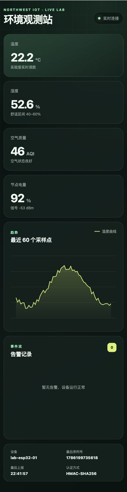
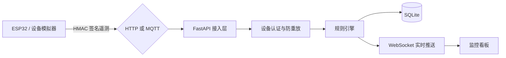

# Northwest IoT Observatory｜物联网环境观测站


一个面向物联网实习作品集的端到端项目：设备通过 HTTP 或 MQTT 上报环境遥测，平台完成 HMAC 设备认证、防重放校验、规则告警、SQLite 持久化与 WebSocket 实时可视化。

<p align="center">
  
</p>

**当前版本：v0.1.0** · [架构设计](docs/architecture.md) · [ESP32 接入](firmware/esp32/README.md) · [贡献指南](CONTRIBUTING.md) · [安全政策](SECURITY.md)

> 这是一个可运行、可测试、可容器化部署的 MVP，也是一条持续迭代路线的起点，不是只有截图和 CRUD 的一次性 Demo。

## 为什么这个项目适合写进简历

- **不是普通 CRUD**：数据来自设备上报链路，包含采集、签名、传输、校验、存储、规则计算和实时推送。
- **能展示物联网核心能力**：MQTT QoS、设备身份、时钟偏差、序列号防重放、弱网与断线重连。
- **容易现场演示**：没有 ESP32 也能用模拟器生成正常、升温和空气质量波动场景。
- **有工程质量**：分层代码、类型校验、自动化测试、容器编排、健康检查和 API 文档。
- **包含真机固件**：ESP32 + BME280，带 NTP 校时、NVS 序列号持久化和 HMAC 上报。

## 系统架构



## 5 分钟启动

要求 Python 3.9+。

```bash
python3 -m venv .venv
source .venv/bin/activate
python3 -m pip install -e ".[dev]"
uvicorn iot_platform.main:app --reload
```

新开一个终端，启动设备模拟器：

```bash
source .venv/bin/activate
iot-simulator --transport http --scenario normal
```

然后访问：

- 实时看板：<http://localhost:8000>
- Swagger API 文档：<http://localhost:8000/docs>
- 健康检查：<http://localhost:8000/api/v1/health>

告警演示：

```bash
iot-simulator --transport http --scenario heatwave --interval 1
```

## MQTT + Docker 完整演示

只启动平台和 Mosquitto：

```bash
docker compose up --build
```

连同模拟设备一起启动：

```bash
docker compose --profile demo up --build
```

## ESP32 真机接入

真机代码位于 `firmware/esp32`，使用 PlatformIO、BME280、NTP 和 ESP32 NVS。接线及烧录步骤见 [`firmware/esp32/README.md`](firmware/esp32/README.md)。

## 安全协议

设备发送的数据示例：

```json
{
  "device_id": "lab-esp32-01",
  "timestamp": 1770000000,
  "sequence": 1024,
  "metrics": {
    "temperature": 25.4,
    "humidity": 48.1,
    "air_quality": 62,
    "battery": 93.2,
    "rssi": -58
  },
  "signature": "HMAC-SHA256..."
}
```

签名内容是去掉 `signature` 后按 key 排序、无多余空格的 JSON。服务端执行三层校验：

1. Pydantic 检查字段范围和设备 ID 格式；
2. HMAC-SHA256 验证消息没有被篡改；
3. 时间窗口和单调递增 `sequence` 阻止旧消息重放。

当前演示版把共享密钥存入 SQLite。生产系统应迁移到密钥管理服务或硬件安全模块，并为 MQTT 开启 TLS 与账号认证；`infra/mosquitto` 的匿名配置只用于本地开发。

## 测试

```bash
ruff check .
ruff format --check .
pytest --cov=iot_platform --cov-report=term-missing --cov-fail-under=65
```

测试覆盖签名篡改、告警规则、完整上报链路、历史查询、重复序列号和错误密钥。GitHub Actions 还会在 Python 3.9/3.12 上运行测试、编译 ESP32 固件并构建 Docker 镜像。

## 建议迭代路线

| 阶段 | 目标 | 可证明的能力 |
|---|---|---|
| V0.1（当前） | 模拟器、MQTT/HTTP、认证、告警、实时看板 | 端到端物联网链路 |
| V0.2 | ESP32 断网缓存、MQTT/TLS 与远程配置 | 嵌入式 C/C++、弱网处理与设备安全 |
| V0.3 | PostgreSQL/TimescaleDB、按时间聚合 | 时序数据建模与查询优化 |
| V0.4 | JWT 用户登录、设备注册、告警规则配置 | 平台化与安全设计 |
| V0.5 | Prometheus/Grafana、压测和故障注入 | 可观测性与可靠性 |

## 面试时的 30 秒介绍

“我做了一个物联网环境监测平台。ESP32 或模拟器通过 MQTT/HTTP 上报温湿度与空气质量；每条消息使用 HMAC 签名，并用时间窗口和序列号防重放。后端用 FastAPI 完成校验、规则告警和时序数据存储，再通过 WebSocket 推到实时看板。项目带自动化测试和 Docker Compose，下一步会接入真实传感器并做断网缓存与 TimescaleDB 优化。”

## 目录

```text
.
├── src/iot_platform/    # API、业务层、MQTT、数据库和看板
├── firmware/esp32/      # PlatformIO 真机固件
├── tests/               # 单元与 API 集成测试
├── infra/mosquitto/     # 本地 MQTT Broker 配置
├── docs/                # 架构说明与项目图片
├── .github/             # CI、Dependabot、Issue/PR 模板
├── compose.yaml         # 完整演示环境
└── README.md
```

## 开源与使用范围

项目采用 [MIT License](LICENSE)。欢迎学习、二次开发和提交 Pull Request。演示密钥、匿名 MQTT 和 SQLite 密钥存储只适用于本地开发；公网部署前请阅读 [SECURITY.md](SECURITY.md)。
