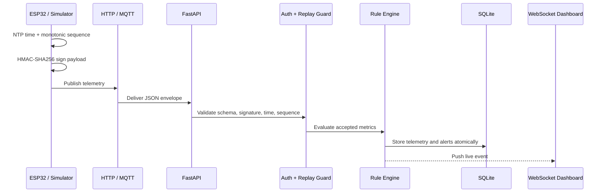

# 架构与设计决策

## 数据链路

## 模块边界

| 模块 | 职责 | 不负责 |
|---|---|---|
| `main.py` | HTTP/WebSocket 协议、生命周期、错误映射 | 业务规则和 SQL |
| `service.py` | 遥测接入用例编排 | 传输协议 |
| `security.py` | 规范化消息、签名与常量时间比较 | 密钥生命周期 |
| `rules.py` | 纯函数告警判断 | 持久化和通知 |
| `database.py` | 事务、索引和查询 | HTTP 状态码 |
| `mqtt_bridge.py` | MQTT 订阅与事件循环桥接 | 业务规则 |

## 关键设计决策

### 为什么同时支持 HTTP 和 MQTT

HTTP 降低第一次运行和调试成本；MQTT 更接近真实物联网平台，并展示主题路由、QoS 和长连接。两种传输最终进入同一个 `TelemetryService`，避免业务逻辑分叉。

### 为什么使用 HMAC、时间窗口和序列号

HMAC 证明消息来自持有共享密钥的设备且未被篡改；时间窗口拒绝很久以前的消息；设备级单调序列号拒绝窗口内的重复消息。三者解决的问题不同，不能互相替代。

### 为什么 MVP 使用 SQLite

SQLite 让项目无需外部数据库即可演示完整链路，并通过 WAL 和设备时间索引支撑轻量并发。规模扩大后应迁移 PostgreSQL/TimescaleDB，并增加保留策略与降采样。

## 已知边界

- 演示密钥以明文存储，生产部署必须接入密钥管理系统；
- 告警规则目前硬编码，后续应支持设备或租户级配置；
- MQTT 本地配置允许匿名连接，公网部署必须启用 TLS 和 ACL；
- ESP32 目前实时上报，下一版本需加入 Flash 环形缓冲区处理断网。
